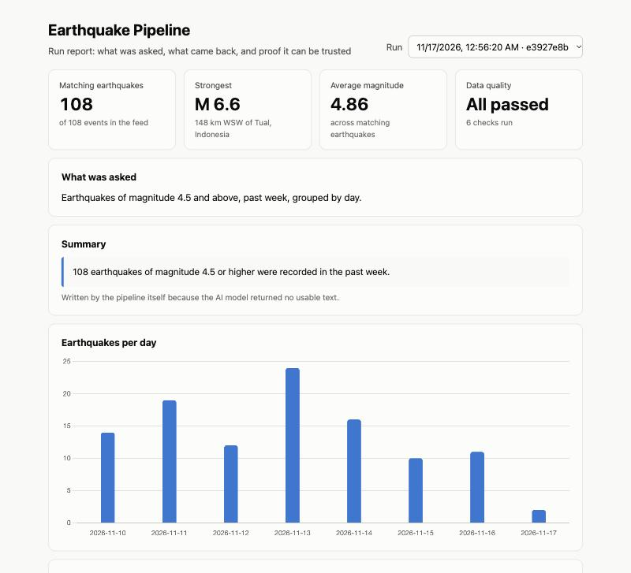
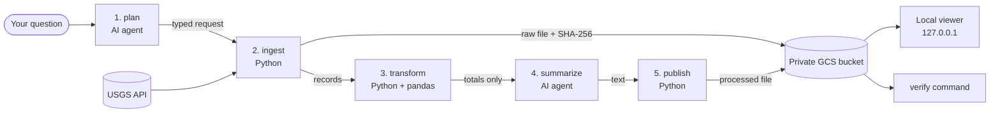

# Quake Pipeline

An agentic data pipeline built with Python and Google's Agent Development Kit
(ADK). You ask a question in plain English:

> earthquakes above magnitude 4.5 in the past week, grouped by day

and it pulls live data from the USGS earthquake API, cleans and aggregates
it, stores the raw and processed files in a private Google Cloud Storage
bucket, and shows the result on a web page. Every run can then be
**independently verified** against its raw file.



## See it in two minutes (no cloud account needed)

Requires Python 3.11 or newer.

```bash
git clone <this-repo-url> && cd quake-pipeline
make install          # if "python3" is older than 3.11: make install PYTHON=python3.12
make demo             # then open http://127.0.0.1:8080
```

Demo mode runs the real ingest, transform, publish and verify code on live
USGS data, but keeps files in memory instead of a bucket and skips the two
AI steps. It exists so anyone can look at the result before doing any setup.
The full pipeline is described below.

## How it works

One ADK `Workflow` runs five steps in a fixed order. The order is set in
code. The AI model is used only where language is needed.



| # | Step | Type | What it does |
| --- | --- | --- | --- |
| 1 | `plan_agent` | AI agent, no tools | Turns the sentence into a typed request: timeframe, minimum magnitude, grouping |
| 2 | `ingest` | Python, retries on network errors | Builds the USGS URL from an allow-list, downloads with limits, validates every record, saves the raw file with its SHA-256 |
| 3 | `transform` | Python + pandas | Removes duplicates, filters, derives day / region / magnitude band, groups and aggregates, and accounts for every row |
| 4 | `summary_agent` | AI agent, no tools | Writes 2 to 3 sentences from the totals only. It never sees raw data |
| 5 | `publish` | Python | Cleans the summary, builds the final result with lineage and quality report, saves it |

Bucket layout:

- `raw/<run_id>.geojson` is the untouched USGS response
- `processed/<run_id>.json` is the result the viewer reads

## Assignment requirements

| Requirement | How it is met | Where |
| --- | --- | --- |
| 1. Ingest from a public API | USGS Earthquake GeoJSON feed, no API key needed | `quake_pipeline/nodes.py` (`run_ingest`) |
| 2. Meaningful processing | De-duplication, filtering, derived columns, grouping, aggregation, top-N | `quake_pipeline/nodes.py` (`run_transform`), `regions.py` |
| 3. Cloud object storage | Raw **and** processed files in a private Google Cloud Storage bucket | `quake_pipeline/storage.py` |
| 4. HTML visualization | Web page with headline numbers, bar chart, table, data quality and lineage | `viewer/` |
| 5. Agentic design with ADK | An ADK graph `Workflow` with two LLM agents and three function nodes | `quake_pipeline/agent.py`, `agents.py` |
| 6. Public repo, reproducible, no credentials | Pinned lock file, one-command install, secrets only in a git-ignored `.env`, automated test that fails if a key is committed | `Makefile`, `requirements.lock`, `tests/test_policy.py` |
| Future improvements document | | [`FUTURE_IMPROVEMENTS.md`](FUTURE_IMPROVEMENTS.md) |

## Full setup

### 1. Install

```bash
make install
```

### 2. Create a private bucket (once)

You need the `gcloud` CLI and a Google Cloud project you can create buckets in.

```bash
# Pick the project and names
export PROJECT_ID="your-project-id"
export BUCKET="your-unique-bucket-name"
export ME="your-google-account@example.com"
gcloud config set project "$PROJECT_ID"

# Enable Cloud Storage
gcloud services enable storage.googleapis.com

# Create a private bucket: IAM-only access, public access blocked
gcloud storage buckets create "gs://$BUCKET" \
  --location=us-central1 \
  --uniform-bucket-level-access \
  --public-access-prevention

# Grant create-only and read-only on this bucket (no delete, no overwrite)
gcloud storage buckets add-iam-policy-binding "gs://$BUCKET" \
  --member="user:$ME" --role=roles/storage.objectCreator
gcloud storage buckets add-iam-policy-binding "gs://$BUCKET" \
  --member="user:$ME" --role=roles/storage.objectViewer

# Log in so Python can use your identity (no key file)
gcloud auth application-default login
```

Confirm the bucket is locked down:

```bash
gcloud storage buckets describe "gs://$BUCKET" \
  --format="default(public_access_prevention,uniform_bucket_level_access)"
```

An account that is already Owner of the project has full storage access
regardless of the two role bindings. They document the minimum the pipeline
needs, and the code enforces create-only by itself.

### 3. Add your settings

```bash
cp .env.example quake_pipeline/.env
```

Then edit `quake_pipeline/.env`: set `GCS_BUCKET`, and either a
`GOOGLE_API_KEY` from Google AI Studio or the three Google Cloud model
settings. The file is git-ignored.

### 4. Check the setup

```bash
make doctor
```

It prints PASS or FAIL for each thing the pipeline needs and says how to fix
any failure. It only reads, and never prints a secret.

### 5. Run, view, verify

```bash
make run QUERY="earthquakes above 4.5 this week by day"
make view       # open http://127.0.0.1:8080 (takes a few seconds to start)
make verify     # re-check the newest run against its raw file
```

The same commands without `make`:

```bash
adk run quake_pipeline "earthquakes above 4.5 this week by day"
python viewer/serve.py
python -m quake_pipeline.verify
```

## What makes a run trustworthy

**Every row is accounted for.** The transform counts what it removes at each
step: unreadable records, duplicates, non-earthquakes (the feed also holds
quarry blasts and explosions), missing magnitudes, and events below the
threshold. If the counts do not add up to the size of the feed, the run
stops instead of publishing.

**Bad data stops the run.** Each record is checked against plausible ranges
(a magnitude of 99 or a date in the year 5000 is rejected). If more than 20%
of a feed is unreadable, the feed format has probably changed, so the run
fails. The raw file is still saved first, so there is evidence to look at.

**Quality checks are published with the result.** Is the feed complete? Is it
fresh? Any duplicates? Any missing depths? The viewer shows each one as
pass or warning.

**Lineage.** Each result records the exact raw file it came from, that
file's SHA-256 fingerprint, the pipeline version and the model used.

**Verify.** `make verify` (or the button in the viewer) re-downloads the raw
file, confirms the fingerprint, re-runs the transform and confirms the
published numbers come out identical. A changed raw file or an edited result
is detected. What it cannot prove: that the AI-written summary sentence is
accurate, or that USGS's data was right.

**Messy source data is normalized.** USGS writes the same place as both "CA"
and "California", and events at sea have no comma at all ("south of the Fiji
Islands"). `regions.py` maps these onto one label so groups are not split.

## Security controls and why each exists

The main idea: keep the model away from anything dangerous. The two AI steps
have no tools, cannot choose URLs and cannot touch storage.

| Threat | Control | Where |
| --- | --- | --- |
| Prompt injection through the user's request (OWASP LLM01) | The planner's output is only accepted through the `PipelineRequest` schema: two fixed-choice fields and one number from 0 to 10. Anything else fails validation and the run stops before any network call | `schemas.py`, `agents.py` |
| Prompt injection through API text such as place names | Labels are cleaned and capped at 80 characters before the summary agent sees them. The agent only receives totals, never raw records | `sanitize.py`, `nodes.py` |
| The agent doing more than intended (OWASP LLM06) | Agents have no tools. Plain functions do all network and storage work. No `GCSToolset`, no code execution | `agents.py`, `nodes.py` |
| Server-side request forgery | The URL is built in code from a fixed host and allow-listed parts, then checked for `https` and the USGS host. Redirects are off | `nodes.py`, `config.py` |
| Oversized, slow or malformed responses, runaway cost (OWASP LLM10) | 10 second timeout per operation, 30 seconds overall, 20 MB cap on decompressed size, shape checks, at most 3 attempts with growing waits, summary capped at 600 characters | `nodes.py`, `config.py` |
| Model or API text running as code in the page (XSS, OWASP LLM05) | The page writes all data with `textContent`. No inline scripts or styles. A Content Security Policy limits everything to same-origin | `viewer/web/app.js`, `viewer/serve.py` |
| Public data leak | Bucket has public access prevention and uniform bucket-level access. The code never makes objects public, sets ACLs or creates signed URLs. The page is served locally | `storage.py`, setup above |
| Over-broad cloud permissions, accidental overwrite | Only `objectCreator` and `objectViewer` on the one bucket. Uploads use `if_generation_match=0`, so an existing object is never replaced | `storage.py` |
| Leaked credentials | Application Default Credentials from `gcloud`. No service account key files. The Gemini key lives only in the git-ignored `quake_pipeline/.env`. Secrets and payloads are never logged | `storage.py`, `logs.py`, `.gitignore` |
| Path traversal in the viewer | Static routes come from a fixed dictionary. Run ids must match a strict pattern before use. No request text is ever joined onto a file path. GET only | `viewer/serve.py` |
| A hostile website reaching the local viewer (DNS rebinding) | The viewer binds to `127.0.0.1` and refuses requests whose Host header is not this machine | `viewer/serve.py` |
| Tampered or vulnerable dependencies (OWASP LLM03) | Every package pinned in `requirements.lock`, scanned by `pip-audit`. Chart.js is stored locally with a recorded SHA-256 instead of a CDN tag | `requirements.lock`, `viewer/web/vendor/README.md` |
| Silent corruption or edits after the fact | SHA-256 of the raw file recorded at ingest. `verify` recomputes the result from the raw file | `verify.py` |

These rules are also written as tests in `tests/test_policy.py`, so breaking
one (adding a tool to an agent, importing `subprocess`, committing a key,
unpinning a dependency) fails the build.

**`adk web` is a development tool only.** Do not start it with
`--allow_origins "*"` for this project. That flag lets any website talk to
the local agent.

**Honest limit:** this is a secure design for a local class project, not a
production deployment. Hosting it for other people would need sign-in on the
viewer, a dedicated service account and network controls. See
[`FUTURE_IMPROVEMENTS.md`](FUTURE_IMPROVEMENTS.md).

## Testing

```bash
make check     # lint + tests with coverage + dependency scan + code scan + banned-pattern guard
```

The tests need no network, no cloud account and no model.

| Area | How it is tested |
| --- | --- |
| The five-step graph | Runs the real ADK `Workflow` end to end with a stub model, mocked HTTP and in-memory storage. Checks retries, schema rejection, and exactly what text each model call is shown |
| Cloud Storage | The **real** `google-cloud-storage` client talks to a small local stand-in for the storage API, proving what goes on the wire (`ifGenerationMatch=0`, no ACLs, no deletes) and that least-privilege roles are enough |
| Ingest | Bad status codes, wrong content type, oversized and slow responses, malformed and deeply nested JSON, redirects, 19 kinds of bad record |
| Transform and quality | Each grouping, ordering, rounding, UTC day boundaries, ties, duplicates, row reconciliation, every quality check |
| Verify | Clean runs pass. A one-byte change to the raw file, edited numbers, a missing raw file and a misplaced result are each detected |
| Viewer | Security headers on every response, traversal attempts, bad run ids, other HTTP methods, hostile Host headers, generic error bodies |
| Security rules | No dangerous imports or calls, agents have no tools, graph order, pinned dependencies, no secrets in the repo, vendored library hash |

Results on 2026-11-17 (Python 3.12): 296 tests passed, 97% coverage,
`ruff` clean, `pip-audit` found no known vulnerabilities across all 89
pinned packages, `bandit` found no issues. A fresh install from
`requirements.lock` in a clean copy of the repo passes the same checks.

The viewer was also checked by hand in a browser for every state (results
by day, region and magnitude band, zero results, no runs yet, a tampered
run, light and dark mode, phone width) with zero console errors and zero
Content Security Policy violations.

## Project layout

```text
quake_pipeline/        the ADK agent package
  agent.py             root_agent = Workflow(...)
  agents.py            plan_agent, summary_agent
  nodes.py             ingest, transform, publish
  quality.py           row accounting and quality checks
  regions.py           place name -> region label
  schemas.py           Pydantic models for every hand-off
  storage.py           GCS create and read helpers
  sanitize.py          cleaning for untrusted text
  verify.py            re-check a stored run against its raw file
  doctor.py            setup check
  config.py            settings, allow-lists, limits
  logs.py              structured logging
viewer/                local web page (127.0.0.1 only)
tools/demo.py          demo mode (no cloud, no model)
tests/                 296 tests
FUTURE_IMPROVEMENTS.md what I would do next
```

Logs: each step writes one JSON line (run id, counts, timings, object
names). `adk run` prints the log file location when it starts.

## Pinned versions

| Package | Version |
| --- | --- |
| google-adk | 2.14.1 |
| google-cloud-storage | 3.17.1 |
| httpx | 0.28.1 |
| pandas | 3.1.1 |
| pytest / pytest-cov | 9.2.0 / 7.1.0 |
| ruff | 0.17.5 |
| pip-audit | 2.10.1 |
| bandit | 1.9.4 |
| Chart.js (vendored) | 4.6.1 |

## Design decisions worth knowing

1. **ADK 2.x graph `Workflow`, not `SequentialAgent`.** ADK 2.0 deprecated
   the old workflow agents. In a graph, plain Python functions are first-class
   steps, so the deterministic work is not left to the model to call.
2. **A plain upload function, not ADK's `GCSToolset`.** The toolset gives the
   model create and delete tools on the bucket. This pipeline never lets the
   model choose a bucket, object name or content.
3. **Importing the package has no side effects.** The bucket setting is
   checked at the start of ingest (before any network call) rather than at
   import, so the setup check, the tests and the viewer can load first.
4. **Optional schema fields default to `None`.** ADK leaves out `None` values
   when it passes a model between steps, so required-but-nullable fields
   would fail validation at the next step.
5. **Magnitude band labels are words** (`Under 2.5`, `6.0 and up`) so that
   every label, with no exceptions, can go through the same cleaning rule.
6. **`HEAD` requests get 405**, following "GET only". `curl -I` still shows
   the security headers. Use `curl -i` to see them on a 200.

## Sources

ADK

- [ADK 2.0 overview](https://adk.dev/2.0/)
- [Graph-based workflows](https://adk.dev/graphs/)
- [Safety and security for agents](https://adk.dev/safety/)
- [Python quickstart](https://adk.dev/get-started/python/)
- [Gemini model setup](https://adk.dev/agents/models/google-gemini/)
- [google-adk on PyPI](https://pypi.org/project/google-adk/)

Google Cloud

- [Public access prevention](https://docs.cloud.google.com/storage/docs/public-access-prevention)
- [Uniform bucket-level access](https://docs.cloud.google.com/storage/docs/uniform-bucket-level-access)
- [IAM roles for Cloud Storage](https://docs.cloud.google.com/storage/docs/access-control/iam-roles)
- [Application Default Credentials for local development](https://docs.cloud.google.com/docs/authentication/set-up-adc-local-dev-environment)

Data and front end

- [USGS GeoJSON summary feed](https://earthquake.usgs.gov/earthquakes/feed/v1.0/geojson.php)
- [Chart.js installation](https://www.chartjs.org/docs/latest/getting-started/installation.html)

Security references

- [OWASP Top 10 for LLM Applications](https://genai.owasp.org/llm-top-10/)
- [OWASP SSRF prevention cheat sheet](https://cheatsheetseries.owasp.org/cheatsheets/Server_Side_Request_Forgery_Prevention_Cheat_Sheet.html)
- [OWASP Content Security Policy cheat sheet](https://cheatsheetseries.owasp.org/cheatsheets/Content_Security_Policy_Cheat_Sheet.html)
